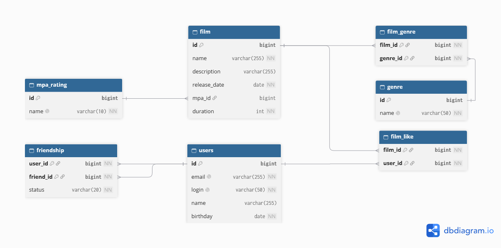

# java-filmorate

Backend-приложение для работы с фильмами и пользователями: добавление фильмов, лайки, дружба, топ популярных фильмов.

## Схема базы данных



## Описание таблиц

| Название     | Назначение                                                                      | Первичный ключ                   |
|--------------|---------------------------------------------------------------------------------|----------------------------------|
| `mpa_rating` | Справочник MPA-рейтингов (G, PG, PG-13, R, NC-17)                               | `id`                             |
| `genre`      | Справочник жанров (Комедия, Драма, Мультфильм, Триллер, Документальный, Боевик) | `id`                             |
| `users`      | Пользователи: email, логин, имя, дата рождения                                  | `id`                             |
| `film`       | Фильмы: название, описание, дата релиза, длительность, MPA-рейтинг              | `id`                             |
| `film_genre` | Связь M:M «фильм — жанр»                                                        | составной `(film_id, genre_id)`  |
| `film_like`  | Лайки фильмов пользователями (уникальная пара)                                  | составной `(film_id, user_id)`   |
| `friendship` | Дружба пользователей со статусом `PENDING` / `CONFIRMED`                        | составной `(user_id, friend_id)` |

## Бизнес-правила

1. **Фильм ↔ жанр** — M:M, реализовано через `film_genre`. Один фильм — любое количество жанров.
2. **Фильм ↔ MPA** — M:1, реализовано через `film.mpa_id`. Каждый фильм имеет не более одного MPA-рейтинга.
3. **Лайк** — уникальная пара `(film_id, user_id)`.
4. **Дружба** — уникальная пара `(user_id, friend_id)` в каждом направлении. Заявка (`PENDING`) при подтверждении
   становится взаимной (`CONFIRMED`). Удаление из друзей — удаление обеих записей.
5. **Популярность** — количество лайков фильма: `COUNT(film_like.user_id)` по `film_id`. Топ-N — сортировка по убыванию.
6. **Общие друзья** — пользователи, у которых есть подтверждённая дружба и с одним, и с другим пользователем.

## Примеры запросов

> **Примечание.** Знак `?` в запросах — это параметр, в который подставляется соответствующее значение, например, Id
> фильма или пользователя.

### Получить все фильмы

```sql
SELECT f.id,
       f.name,
       f.description,
       f.release_date,
       f.duration,
       m.id   AS mpa_id,
       m.name AS mpa_name,
       g.id   AS genre_id,
       g.name AS genre_name
FROM film f
LEFT JOIN mpa_rating m ON m.id = f.mpa_id
LEFT JOIN film_genre fg ON fg.film_id = f.id
LEFT JOIN genre g ON g.id = fg.genre_id
ORDER BY f.id, g.id;
```

### Получить фильм по идентификатору

```sql
SELECT f.id,
       f.name,
       f.description,
       f.release_date,
       f.duration,
       m.id   AS mpa_id,
       m.name AS mpa_name,
       g.id   AS genre_id,
       g.name AS genre_name
FROM film f
LEFT JOIN mpa_rating m ON m.id = f.mpa_id
LEFT JOIN film_genre fg ON fg.film_id = f.id
LEFT JOIN genre g ON g.id = fg.genre_id
WHERE f.id = ?;
```

### Получить всех пользователей

```sql
SELECT id, email, login, name, birthday
FROM users
ORDER BY id;
```

### Получить пользователя по идентификатору

```sql
SELECT id, email, login, name, birthday
FROM users
WHERE id = ?;
```

### Топ-N популярных фильмов по количеству лайков

```sql
SELECT f.id,
       f.name,
       COUNT(fl.user_id) AS likes_count
FROM film f
LEFT JOIN film_like fl ON fl.film_id = f.id
GROUP BY f.id, f.name
ORDER BY likes_count DESC, f.id ASC
LIMIT ?;
```

### Список друзей пользователя (только подтверждённые)

```sql
SELECT u.id, u.email, u.login, u.name, u.birthday
FROM users u
JOIN friendship f ON f.friend_id = u.id
WHERE f.user_id = ?
  AND f.status = 'CONFIRMED'
ORDER BY u.id;
```

### Общие друзья двух пользователей

```sql
SELECT u.id, u.email, u.login, u.name, u.birthday
FROM users u
JOIN friendship f1
  ON f1.friend_id = u.id
 AND f1.user_id = ?
 AND f1.status = 'CONFIRMED'
JOIN friendship f2
  ON f2.friend_id = u.id
 AND f2.user_id = ?
 AND f2.status = 'CONFIRMED'
ORDER BY u.id;
```